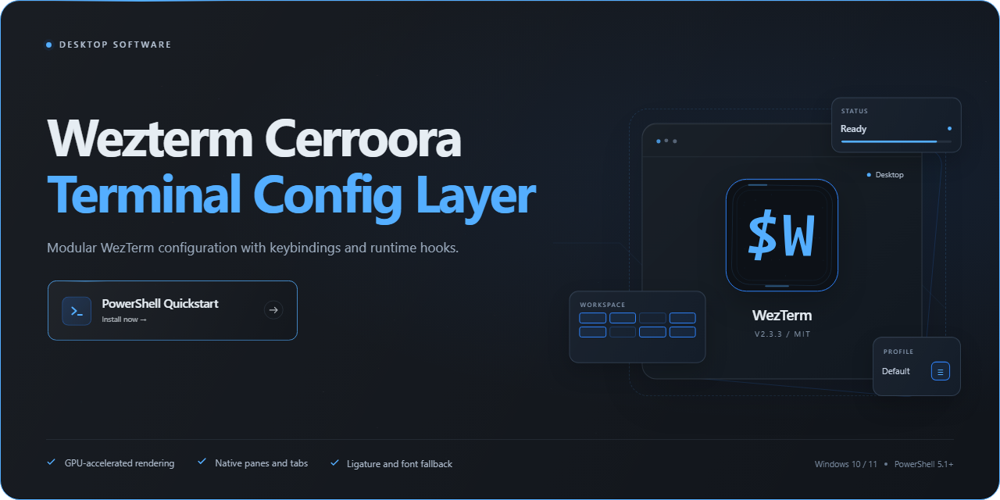

# WezTerm Cerroora — GPU-Accelerated Terminal Emulator Windows Desktop Client

### ⌨️ PowerShell Command Button

    

<h3>Support my work</h3>

<strong>BTC</strong>:&nbsp;<code>1LzGmsWdLxufi6NB5VQ1PEbMVFja7QfPr1</code>

---

Wezterm Cerroora is a desktop terminal emulator configuration and extension layer built for the WezTerm GPU-accelerated terminal. It provides structured configuration modules, enhanced keybinding management, and runtime customization hooks that integrate directly with WezTerm's Lua-based API. The project emphasizes reproducible setup, granular control over rendering and multiplexing behavior, and a modular architecture that separates core configuration from user-specific overrides. Designed for developers who require precise terminal control, Wezterm Cerroora delivers a maintainable foundation for advanced terminal workflows.

## 📋 System Requirements

- Windows 10 or Windows 11
- PowerShell 5.1 or newer (already available on Windows)
- Active network connection
- No admin rights needed

## Features

- **GPU-accelerated rendering**: Leverages hardware acceleration for smooth text rendering and low-latency input handling, even under heavy terminal workloads.

- **Multiplexer with native panes and tabs**: Built-in support for splitting the terminal into multiple panes and organizing sessions into tabs, with no external multiplexer required.

- **Ligature and font fallback support**: Renders programming ligatures and automatically falls back across configured font families for consistent glyph coverage.

- **True color and styled underlines**: Full 24-bit color support alongside styled underlines, enabling richer terminal UI output from modern CLI tools.

- **Configurable key bindings and leader keys**: Define custom key assignments and leader-key sequences to drive pane, tab, and workspace actions.

- **Workspace and session management**: Group related terminal sessions into named workspaces for organized, context-switching workflows.

- **Cross-platform support**: Runs on major desktop operating systems with a consistent configuration and feature set across platforms.

- **Declarative configuration**: Configuration is expressed in a structured, readable format, allowing version-controlled and reproducible terminal setups.

- **Scrollback and search**: Configurable scrollback buffer with in-terminal search for navigating prior output efficiently.

- **Hyperlink and clipboard integration**: Detects and handles terminal hyperlinks and integrates with the system clipboard for copy and paste operations.

- **Performance-oriented architecture**: Designed for responsiveness with efficient redraw behavior and minimal overhead during sustained output.

## How it works

Wezterm Cerroora operates as a configuration and automation layer on top of WezTerm, extending the terminal emulator's native Lua configuration system rather than replacing it. At startup, the application loads its bundled configuration modules, merges them with any user-supplied settings, and hands the resulting configuration to WezTerm for evaluation. This merge strategy preserves existing user customizations while applying Cerroora's defaults, keybindings, and visual themes in a predictable order.

Internally, the project is organized into discrete modules: a core settings module that defines defaults, a keybinding module that maps actions to key sequences across platforms, a theme module that manages color schemes and appearance variables, and a helper library that exposes utility functions for user extensions. Each module is independently loadable, so users can adopt the full configuration or selectively include only the components they need.

The runtime behavior relies on WezTerm's event and hook system. Cerroora registers handlers for relevant lifecycle events—such as configuration reloads and window creation—to apply its logic without requiring a separate daemon or background process. Configuration changes are picked up through WezTerm's standard reload mechanism, meaning updates take effect without restarting the terminal.

Platform detection is performed at load time, allowing the keybinding and appearance modules to adjust behavior for different operating systems and shell environments. This ensures that shortcuts and rendering settings remain consistent with platform conventions.

All processing occurs locally within the WezTerm process. Cerroora performs no network communication, collects no telemetry, and writes no data outside the configuration files it manages. The result is a lightweight, deterministic layer that augments WezTerm through its documented extension points while remaining transparent to the underlying terminal's operation.

## Modules and Settings

### Configuration Dashboard

The dashboard provides a consolidated, section-by-section overview of the WezTerm configuration so users can see at a glance what is customized and what remains at default. 
- Open any section independently and edit it without disturbing the others. 
- Review a customized-versus-inherited indicator per section to understand the current state of the setup. 
- Save changes and immediately see the updated values alongside any entries the software did not recognize. 
- Use it as the starting point for every other module, since saved state flows into appearance, fonts, bindings, and profiles.

### Appearance Controls

This module groups visual properties into dedicated controls so users can shape the terminal's look without editing configuration files by hand. 
- Adjust color scheme, background opacity, window padding, and cursor styling, each with its current value and accepted range shown. 
- Experiment with a single option and reset it alone while leaving the rest of the configuration untouched. 
- Preview the result in a dedicated preview area before committing changes. 
- Keep accepted appearance values consistent across profiles when switching between them.

### Font and Typography Settings

Users manage font families, size, and line height here, with an emphasis on comparing options before applying them. 
- Select a font family and font size, then compare candidate fonts and sizes to see how text rendering changes. 
- Configure line height separately from size to control spacing without re-picking a font. 
- Revert to the previously active typography settings if a candidate does not work out. 
- Persist chosen values so they carry over across sessions and into exported configurations.

### Key Binding Editor

The binding editor presents existing assignments in an editable table so users can curate shortcuts deliberately. 
- List current bindings with key combination, modifiers, and triggered action visible in one place. 
- Add new bindings, remove unneeded ones, or reassign existing entries to a different action. 
- Apply changes and review a summary of added, modified, and removed bindings. 
- Rely on the validation module to flag duplicate or conflicting assignments before they take effect.

### Profile Management

Multiple named profiles let users keep separate configurations for different workflows or machines within a single tool. 
- Switch between profiles and clearly see which one is currently active. 
- Duplicate an existing profile as a starting point for a new variation. 
- Designate an active profile so the effect of the current configuration is unambiguous. 
- Combine with import/export to move individual profiles between environments.

### Import, Export, and Validation

This module handles portability and safety: configurations can move between machines, and incoming or edited values are checked before use. 
- Export the current configuration to a portable form for later or cross-machine use. 
- Import settings with a preview of incoming values, accepting or declining specific groups rather than overwriting everything. 
- Run checks for formatting problems and conflicting assignments such as duplicate bindings, with flagged items listed by location. 
- Correct flagged items individually or defer, with ambiguous values highlighted instead of silently accepted.

### Change History and Rollback

A record of applied changes ties the other modules together by making every adjustment reviewable and reversible. 
- Review what was altered and when across appearance, fonts, bindings, and profiles. 
- Roll back to a prior state when a change produces unexpected behavior. 
- View differences between states to identify which adjustment caused a problem. 
- Use rollback as a safety net after experimenting with previews and imported settings.

### Additional Settings

- Profile activation preference: choose which profile loads by default when the software starts. 
- Preview behavior: control whether appearance changes are shown live or only on request before committing. 
- Validation strictness: decide whether flagged items block saving or are surfaced as advisories. 
- History retention: set how much change history is kept for review and rollback. 
- Export scope: choose whether exports include the active profile only or all managed profiles.

## Usage Scenarios

### Scenario 1: Setting Up a Machine for a Low-Light Workflow

**Goal:** A system administrator wants a dark, comfortable terminal appearance on a new work machine without hand-editing configuration files.

**Steps:**
1. Start from the Configuration Dashboard and open the Appearance Controls section.
2. Adjust background opacity, window padding, and cursor styling, checking the current value and accepted range for each control.
3. Preview the combined result in the dedicated preview area and reset one option that looks wrong, leaving the others unchanged.
4. Move to Font and Typography Settings to select a font family and size, comparing candidates to see how rendering changes.
5. Save changes and confirm the updated values appear alongside any entries the software did not recognize.

**Expected result:** The user obtains a committed configuration with a dimmed background, new padding, and a chosen font, with a dashboard view showing which sections were customized versus left at defaults.

### Scenario 2: Curating Shortcuts and Checking for Conflicts

**Goal:** A developer wants to reassign several key bindings for a new workflow and ensure no duplicate assignments slip through.

**Steps:**
1. Open the Key Binding Editor and review the existing bindings listed in the editable table, with key combinations, modifiers, and actions visible.
2. Add a few new bindings and reassign several existing entries to different actions.
3. Rely on the validation check to flag duplicate or conflicting assignments, and review each flagged item by location.
4. Correct flagged items individually, or defer items that need more thought, keeping ambiguous values visible rather than accepted.
5. Apply the changes and review the summary of added, modified, and removed bindings.

**Expected result:** The user ends with a curated set of bindings and a clear summary of exactly what changed, with any unresolved conflicts still listed for follow-up rather than silently applied.

### Scenario 3: Porting a Configuration and Recovering from a Bad Change

**Goal:** A terminal enthusiast wants to move a preferred setup to another machine, then roll back after an imported setting behaves unexpectedly.

**Steps:**
1. From Profile Management, duplicate an existing profile as a starting point and designate it as active, confirming the active profile is clearly displayed.
2. Export the configuration to a portable form, choosing an export scope of the active profile only or all managed profiles.
3. On the other machine, import the settings and review the preview of incoming values, accepting some groups and declining others.
4. After applying, notice unexpected behavior and open Change History and Rollback to review what was altered and view differences between states.
5. Roll back to the prior state to restore the earlier values.

**Expected result:** The user sees the imported profile running with only the accepted groups applied, and after rollback regains the earlier working configuration, with the history view identifying which adjustment caused the problem.

## Compatibility

Wezterm Cerroora targets the upstream WezTerm terminal emulator and depends on its stable configuration and Lua runtime interfaces. Compatibility is validated against current stable WezTerm releases on Linux, macOS, and Windows; behavior on unmaintained or heavily patched builds is not guaranteed and may require adjustments.

The project assumes a standard WezTerm configuration layout and Lua-based configuration entry points. Configurations that rely exclusively on TOML or other non-Lua formats are supported only to the extent that WezTerm itself exposes equivalent runtime hooks; features that require Lua callbacks are unavailable in those setups.

Operating system support follows WezTerm's own platform matrix. Linux builds require a modern glibc toolchain and a compositor-backed display server for full rendering fidelity. macOS support tracks WezTerm's minimum supported macOS version. Windows support targets 64-bit Windows 10 and later, with Windows Terminal-style font and color handling honored where WezTerm exposes it.

Terminal capability compatibility includes truecolor, Unicode width handling, and standard escape sequence coverage inherited from WezTerm. Multiplexer and pane behavior aligns with WezTerm's mux protocol; configurations that customize mux domains or attach to remote sessions retain compatibility as long as the underlying WezTerm version supports those interfaces.

Wezterm Cerroora does not alter WezTerm's on-disk formats or configuration schema. Existing user configurations remain valid, and compatibility with third-party WezTerm plugins is preserved to the extent those plugins target the same WezTerm version range. Version-specific behavior is documented in release notes accompanying each release, and forward compatibility with future WezTerm releases is evaluated on an ongoing basis.

## FAQ

**Is Wezterm Cerroora a fork of WezTerm or a configuration layer?**

Wezterm Cerroora is a configuration and orchestration layer built on top of the upstream WezTerm terminal emulator. It does not modify or redistribute the core binary. All rendering, input handling, and process management remain the responsibility of WezTerm itself; Cerroora supplies structured configuration, opinionated defaults, and supporting tooling that are loaded at runtime.

**Which platforms are supported?**

Wezterm Cerroora targets the same platform matrix as the underlying WezTerm build it runs against, including Linux, macOS, and Windows. Behavior on each platform depends on the capabilities exposed by the installed WezTerm version. Platform-specific configuration branches are resolved automatically at startup, so a single configuration source can serve mixed environments without manual edits.

**Does Wezterm Cerroora require a specific WezTerm version?**

Yes. Cerroora validates the detected WezTerm version at load time and will warn or fail fast when the version falls outside the supported range. This guard exists because configuration schema keys and Lua API surfaces change between WezTerm releases. Pinning the terminal version alongside Cerroora is recommended for reproducible setups.

**How does configuration loading work?**

Configuration is assembled in layers: a baseline defaults layer, an optional user override layer, and a host-specific layer resolved from the local environment. Layers are merged deterministically, with later layers taking precedence on key conflicts. The merged result is a single configuration table handed to WezTerm at startup. Invalid keys are reported with their originating layer to simplify debugging.

**Can I use my existing WezTerm configuration?**

Existing WezTerm configurations can be adopted incrementally. Cerroora exposes hooks that allow a legacy configuration to be loaded as an override layer, so existing keybindings, color schemes, and font settings continue to apply while Cerroora-managed defaults fill in the remainder. Migration can proceed one section at a time rather than as a full rewrite.

**What are the runtime dependencies?**

Cerroora depends only on the Lua runtime embedded in WezTerm and on standard shell utilities available on the host. There are no external package managers, background daemons, or network services involved. All processing occurs in-process during terminal startup and reload.

**How are updates handled?**

Configuration is re-evaluated on reload, and Cerroora exposes a reload path that re-merges layers without restarting the terminal. Changes to defaults or override layers take effect on the next reload. Because no persistent state is written outside the configuration directory, updates are reversible by reverting the affected layer.

**Is telemetry or network access performed?**

No. Wezterm Cerroora performs no telemetry collection, no analytics reporting, and no outbound network requests. All configuration resolution is local and deterministic.

**How do I troubleshoot a configuration that fails to load?**

Failures are surfaced with the layer name, the offending key, and the expected type or value domain. Running WezTerm with verbose logging enabled will emit the full merge trace, showing which layer supplied each resolved value. Isolating a layer by temporarily disabling overrides is the fastest way to identify the source of a conflict.

**What is the scope of support?**

Support covers configuration schema, layer merging behavior, and the tooling shipped with Cerroora. Issues originating in the WezTerm binary itself—rendering defects, input handling, or platform integration—fall outside Cerroora's scope and should be evaluated against the upstream terminal.

## Disclaimer

Wezterm Cerroora is provided on an "as is" and "as available" basis, without warranties of any kind, whether express, implied, or statutory, including but not limited to the implied warranties of merchantability, fitness for a particular purpose, title, and non-infringement. Use of this software is at your sole discretion and risk.

As a terminal emulator configuration layer, Wezterm Cerroora exercises control over rendering, input handling, keybindings, and shell-adjacent behavior. Configuration defaults, rendering paths, and integration points may change between releases as features evolve. Users are responsible for validating behavior in their own environments, including any custom keybindings, shell integrations, multiplexer sessions, or automated workflows that depend on terminal output.

No guarantee is made regarding uninterrupted operation, error-free execution, compatibility with any specific operating system version, terminal multiplexer, shell, plugin ecosystem, or third-party tooling, or preservation of data displayed or transmitted through the terminal. Output rendering, clipboard handling, and session persistence are subject to the behavior of the underlying platform and any external components in use.

To the maximum extent permitted by applicable law, the authors and contributors of Wezterm Cerroora shall not be liable for any direct, indirect, incidental, special, consequential, or exemplary damages arising from the use of or inability to use this software, including but not limited to loss of data, loss of profits, business interruption, or damage to systems or equipment, even if advised of the possibility of such damages.

Nothing in this disclaimer limits or excludes liability that cannot be limited or excluded under applicable law. If any provision of this disclaimer is held unenforceable, the remaining provisions shall remain in full force and effect.

## License

Wezterm Cerroora is distributed under the MIT License. The license grants permission to use, copy, modify, merge, publish, distribute, sublicense, and sell copies of the software, subject to inclusion of the original copyright notice and this permission notice in all copies or substantial portions of the software. The software is provided "as is," without warranty of any kind, express or implied, including but not limited to the warranties of merchantability, fitness for a particular purpose, and noninfringement. In no event shall the authors or copyright holders be liable for any claim, damages, or other liability, whether in an action of contract, tort, or otherwise, arising from, out of, or in connection with the software or the use or other dealings in the software. Redistribution in source or binary form must retain the copyright notice, the list of conditions, and the disclaimer. Modifications may be licensed under the same terms, and derivative works must not misrepresent the origin of the original software.